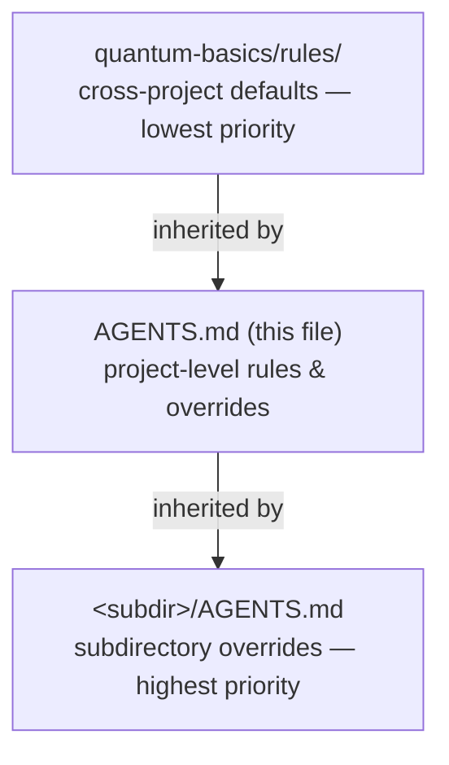
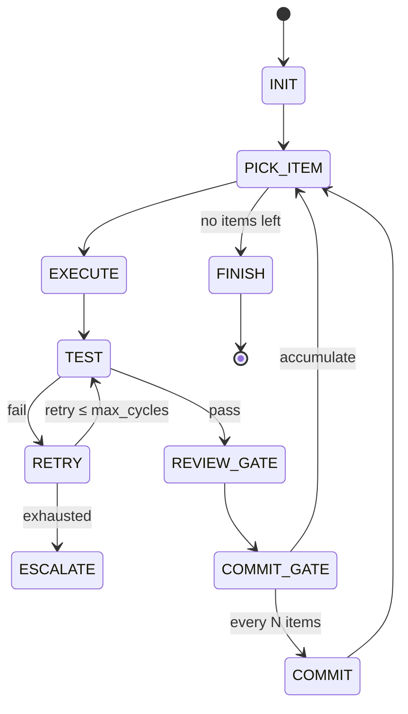

# AGENTS.md — Pocket Voice Recorder

Operating contract for AI assistants working in this repo. Project facts live in
[CONTEXT.md](CONTEXT.md); this file governs **how** you work.

---

## 0. Load order (inheritance model)

Baseline behavior comes from the **quantum-basics** submodule at
[quantum-basics/](quantum-basics/). This file layers project specifics on top.



Any quantum-basics rule applies unless explicitly overridden below. On conflict:
subdir > this file > quantum-basics > common sense.

**At session start, read:**
1. [CONTEXT.md](CONTEXT.md) — what this project is
2. [quantum-basics/rules/communication.md](quantum-basics/rules/communication.md) — how to talk
3. [quantum-basics/rules/workflow.md](quantum-basics/rules/workflow.md) — how to execute
4. [quantum-basics/rules/coding-standards.md](quantum-basics/rules/coding-standards.md) — how to write code

---

## 1. quantum-basics map — every aspect, and when it applies

| Area | Source | Load when |
|---|---|---|
| Communication style | [rules/communication.md](quantum-basics/rules/communication.md) | Always — governs every response |
| Workflow & git | [rules/workflow.md](quantum-basics/rules/workflow.md) | Always — governs task execution |
| Coding standards | [rules/coding-standards.md](quantum-basics/rules/coding-standards.md) | Any code change |
| Diagrams | [rules/diagrams.md](quantum-basics/rules/diagrams.md) | Any diagram — always Mermaid, never ASCII |
| Decision-making | [rules/decision-making.md](quantum-basics/rules/decision-making.md) | Trade-off calls *(planned v0.2 — apply §5 here until it lands)* |
| Optional hooks | [hooks/README.md](quantum-basics/hooks/README.md) | On attach — ask which to enable; see §7 |
| Rules index / priority | [rules/_index.md](quantum-basics/rules/_index.md) | Resolving rule conflicts |
| Language/tool/env prefs | [preferences/_index.md](quantum-basics/preferences/_index.md) | Choosing versions/tools *(planned v0.2)* |
| Reusable patterns | [patterns/_index.md](quantum-basics/patterns/_index.md) | Error handling, testing, docs structure *(planned v0.2)* |
| Interaction examples | [examples/_index.md](quantum-basics/examples/_index.md) | Calibrating good vs. anti-pattern responses *(populated over time)* |
| todo-workflow skill | [skills/todo-workflow/](quantum-basics/skills/todo-workflow/) | Any multi-step task (>3 steps) — see §3 |
| quantum-crew integration | [connections/quantum-crew.md](quantum-basics/connections/quantum-crew.md) | Architecture sessions / ADRs — see §4 |

Files marked *planned* are referenced by their index but not yet written upstream.
When a submodule update adds them, they take effect automatically — no change here.

---

## 2. Distilled operating rules

The full text is authoritative; this is the fast reference.

**Communication** ([source](quantum-basics/rules/communication.md))
- Concise, direct, factual. No preamble ("I'll help…", "Let me…", "Sure!").
- State what *is*, not what "seems to be." Specific numbers ("7 files"), not "several."
- Answer first, context second. Report what was done, not what you're about to do.
- No emojis, no enthusiasm markers, no false empathy, no excessive apology.
- Don't hedge with "might/could/possibly" — be confident or say "I don't know."
- Lead with the problem. State assessments as conclusions, not menus. Disagree openly.

**Workflow** ([source](quantum-basics/rules/workflow.md))
- Action-oriented: understand → execute → verify → report → iterate.
- Don't ask permission to proceed on reversible work; ask only on ambiguity or
  destructive/expensive operations.
- Incremental: small commits, working features over complete systems, show progress.
- Prefer parallel/bulk tool use; don't re-read unchanged files.

**Diagrams** ([source](quantum-basics/rules/diagrams.md))
- Every diagram is a fenced ` ```mermaid ` block — no ASCII art, no image tools.
- Right type for the job: `flowchart`, `sequenceDiagram`, `stateDiagram-v2`, `erDiagram`.
- Convert any ASCII diagram to Mermaid when you touch its file.

**Coding standards** ([source](quantum-basics/rules/coding-standards.md))
- Clarity over cleverness; explicit over implicit; follow surrounding style.
- Descriptive names, small focused functions, early returns, shallow nesting.
- Don't swallow errors — log with context, validate inputs early, actionable messages.
- Comments explain *why*, not *what*. Delete commented-out code. No debug leftovers.
- Per-language: see source (TS: no `any`, `const` default, `async/await`; Python: PEP 8,
  type hints, `pathlib`, f-strings). Project-specific stacks: see §6.

**Git** ([source](quantum-basics/rules/workflow.md#git-workflow))
- Commit after completing a task unless told not to. **Ask before pushing** if the
  branch/remote is unconfirmed — do not guess (this repo has no remote yet).
- Conventional commits: `<type>(<scope>): <description>`, imperative, ~50 chars.
- Stage specific files, not `git add -A`. Never force-push without explicit permission.
- One logical change per commit; don't bundle unrelated changes.

---

## 3. Multi-step work — todo-workflow skill

For any task over ~3 steps (features, refactors, migrations, multi-step fixes), use
the [todo-workflow skill](quantum-basics/skills/todo-workflow/README.md) as the
concrete procedure. It's a state machine:



- Full procedure: [workflow.md](quantum-basics/skills/todo-workflow/workflow.md)
- Per-type validation: [checklist.md](quantum-basics/skills/todo-workflow/checklist.md)
- Item/commit/review formats: [templates.md](quantum-basics/skills/todo-workflow/templates.md)

Defaults: `review_mode=review-code`, `max_cycles=3`, `commit_every=1`, `push=true`.
**Override for this repo:** `push=false` until a remote is configured (§5). Item syntax
supports `[code] [docs] [config] [critical] [depends: N] [batch: name]`.

Skip the skill for single-file quick fixes and simple doc edits.

---

## 4. quantum-crew

If asked to run an architecture session from a spec (e.g. [specs.md](specs.md)),
see [connections/quantum-crew.md](quantum-basics/connections/quantum-crew.md).
quantum-crew spawns Architect/Developer/QA/PO agents that produce ADRs — and those
agents inherit the rules above as their behavioral baseline. quantum-crew is a
separate repo (`quantum-crowbar/quantum-crew`), not yet vendored here.

---

## 5. Project-specific overrides & decisions

Until [rules/decision-making.md](quantum-basics/rules/decision-making.md) ships, apply:
recommend the correct option directly, name the assumption a plan is betting on, flag
failure modes before endorsing.

Overrides that win over quantum-basics defaults in this repo:
- **No auto-push.** This repo has no git remote. Commit locally; ask before adding a
  remote or pushing (`push=false` in todo-workflow).
- **No AI metadata in commits.** The `no-ai-metadata` hook is enabled here (see §7) —
  do NOT add `Co-Authored-By: Claude` or "Generated with Claude Code" trailers. The
  `commit-msg` hook strips them as a backstop, but don't write them in the first place.
- **Mermaid only for diagrams** — per [rules/diagrams.md](quantum-basics/rules/diagrams.md),
  already applied across README/CONTEXT/specs/this file.
- **Hardware reality gates firmware.** Firmware v0.1 is unvalidated on hardware — never
  claim a firmware feature "works"; say "written, not yet flashed" (see CONTEXT.md).
- **Privacy is non-negotiable.** No cloud, no server, no telemetry, no network calls in
  firmware or app. If a change would send data off-device, stop and flag it. This is the
  project's defining architectural constraint.
- **Don't edit the submodule casually.** Changes inside [quantum-basics/](quantum-basics/)
  belong upstream; only bump the pinned ref deliberately with a `chore: update
  quantum-basics` commit.

---

## 6. Stacks in this repo

Match quantum-basics coding standards, specialized per component (details in CONTEXT.md):

- **firmware/** — C++ (Arduino/ESP32-S3). Match ESP32 Arduino core idioms; pins are the
  contract in [hardware/pinout.md](hardware/pinout.md). Serial over native USB-C for debug.
- **android/** — Kotlin + Jetpack Compose, MVVM. On-device only (BLE + whisper.cpp + Room).
- **hardware/** — wiring + enclosure CAD; treat pinout.md as source of truth.

---

## 7. Enabled optional hooks

Chosen when quantum-basics was attached (see the
[attach protocol](quantum-basics/hooks/README.md)):

| Hook | State | Enforcement |
|---|---|---|
| `no-ai-metadata` | **enabled** | `commit-msg` hook at [.githooks/commit-msg](.githooks/commit-msg), activated via `git config core.hooksPath .githooks` |

After cloning, each collaborator must run `git config core.hooksPath .githooks` once to
activate the hook locally (hook config is per-clone; the script itself is committed).
To change hook choices, say "change hooks".

---

**Bottom line:** read CONTEXT.md for *what*, follow quantum-basics for *how*, use
todo-workflow for anything multi-step, diagrams are Mermaid, keep everything on-device,
no AI trailers in commits, and don't push without asking.
