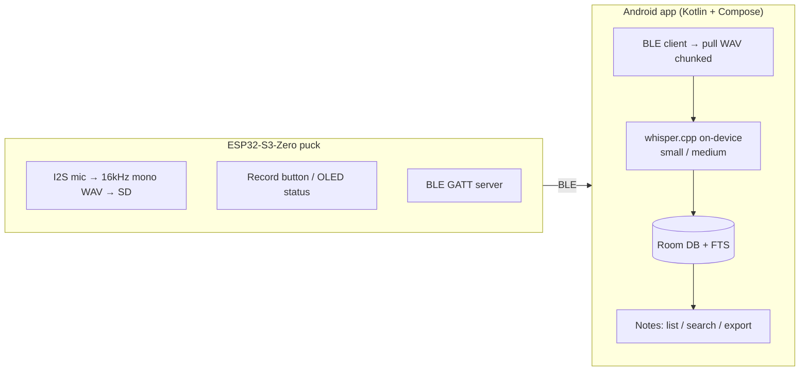

# CONTEXT.md — Pocket Voice Recorder

Project facts for agents. For *how to work*, see [AGENTS.md](AGENTS.md). Full spec:
[specs.md](specs.md) (single source of truth — this file distills it).

---

## What it is

A pocket-sized, **fully offline** voice recorder. An ESP32-S3 puck captures audio to a
microSD card, syncs to an Android app over Bluetooth Low Energy, and transcribes
on-device with whisper.cpp. No server, no cloud, no WiFi. Housed in a custom
3D-printed card-shaped enclosure.

**Defining constraint:** everything stays on-device. This is what distinguishes it
from typical cloud "AI note takers." Any change that sends data off-device violates
the project premise — flag it, don't do it.

---

## Repository layout

| Path | Contents |
|---|---|
| [firmware/](firmware/) | ESP32-S3 Arduino/PlatformIO project (C++) |
| [android/](android/) | Android app (Kotlin + Jetpack Compose, MVVM) |
| [hardware/](hardware/) | [pinout.md](hardware/pinout.md) + [enclosure/](hardware/enclosure/) CAD/STLs |
| [docs/](docs/) | Design docs, open questions |
| [quantum-basics/](quantum-basics/) | Submodule — agent rules/preferences/skills (see AGENTS.md) |
| [specs.md](specs.md) | Master specification |
| [AGENTS.md](AGENTS.md) | Agent operating contract |

---

## Hardware

**MCU:** Waveshare ESP32-S3-Zero (USB-C; no built-in mic/SD; no JST charging).
**Key constraint:** ESP32-S3 is **BLE only** — no Classic Bluetooth (BR/EDR/SPP).
Sync must be a BLE GATT service, not SPP. Expect ~20–500 KB/s; negotiate MTU ≥247 and
use chunked transfer with progress for longer clips.

Peripherals (all wired per [hardware/pinout.md](hardware/pinout.md)):
- I2S MEMS mic → GPIO4 (BCLK) / GPIO5 (WS) / GPIO6 (DOUT), L/R→GND (mono)
- SPI microSD → GPIO7/8/9/10 (SCK/MISO/MOSI/CS)
- I2C OLED SSD1306 128×64 @0x3C → GPIO12 (SCL) / GPIO11 (SDA)
- Record button → GPIO2, `INPUT_PULLUP` (short = record, long = sync, planned)
- Power: LiPo → TP4056 → slide switch → ESP32 5V; charging independent of switch

**Pending purchase:** microSD card, LiPo battery. **Have:** everything else. Full parts
list in [hardware/bom.md](hardware/bom.md). `pinout.md` is the wiring contract — treat
GPIO assignments as fixed unless the user changes them there.

---

## Firmware — status: v0.1 written, NOT yet flashed/validated on hardware

Never describe firmware features as "working." Correct framing: "written, not yet
flashed." See [firmware/README.md](firmware/README.md).

**Implemented (v0.1):** I2S capture → 16kHz mono WAV on SD; debounced record-button
toggle; OLED status (idle/recording, filename, elapsed, free space); WAV header
patched on close.

**Not yet:** BLE sync (GATT server, file list, chunked transfer, control commands);
MTU negotiation; VAD auto-trigger; deep sleep / power management; battery % (needs ADC
on battery rail — TBD).

**Build:** Board "ESP32S3 Dev Module", USB CDC on boot **enabled** (Serial over native
USB-C). Libs: `Adafruit_GFX`, `Adafruit_SSD1306`, core `SD`/`SPI`/`Wire`/`driver/i2s.h`.
The v0.1 sketch is not yet committed — sources drop into `firmware/`.

---

## Android app

Kotlin + Jetpack Compose, MVVM. **No server component.** Target device: Flip 7
(Snapdragon 8 Elite) — expected to run whisper.cpp `small`/`medium` comfortably.

**Flow:** BLE scan/connect (GATT client) → pull file list → pull WAV (chunked) →
queue on-device transcription (whisper.cpp Android bindings) → store transcripts in
Room DB with FTS → Notes screen (list/search/read/export via share sheet).

**Screens:** Home (status/connect), Record (device recording list), Sync & Transcribe
(pull + transcription queue/progress), Notes (transcript list/search/export).

Project scaffolding not yet generated — see [android/README.md](android/README.md).

---

## Enclosure

3D-printed "half-card," ~92×32mm, ~10–12mm thick (stacks MCU + TP4056 + LiPo + SD
reader). Front: OLED window, record button, mic port, optional LED. One short edge:
dual USB-C cutouts (ESP32 + TP4056). Opposite edge: SD slot + power switch.
**Biggest open risk:** SD reader module (~29×48mm) may drive case size — confirm real
dimensions before finalizing CAD. CAD tool TBD.

---

## Roadmap (current: Phase 0–1)

Working roadmap with dependencies, blockers, and milestones: [docs/roadmap.md](docs/roadmap.md).

- **Phase 0** — Hardware bring-up *(in progress; SD card + LiPo pending, then solder & bench-test)*
- **Phase 1** — Base firmware *(v0.1 written; flash & validate on hardware next; add battery %)*
- **Phase 2** — BLE sync *(BLE-only resolved; GATT file list + chunked transfer + MTU + long-press sync)*
- **Phase 3** — Android app *(GATT client → pull → whisper.cpp → Room/FTS → Notes)*
- **Phase 4** — 3D-printed enclosure *(confirm module dims → layout → CAD → test fit)*
- **Phase 5** — Polish/stretch *(VAD auto-record, deep sleep, battery indicator)*

---

## Open questions

- CAD tool preference for the enclosure (Fusion 360 / FreeCAD / OpenSCAD)
- Whether the mic needs a felt/mesh dust cover behind its acoustic port
- Exact SD reader module footprint vs. final case dimensions
- Battery ADC wiring for on-screen battery %
