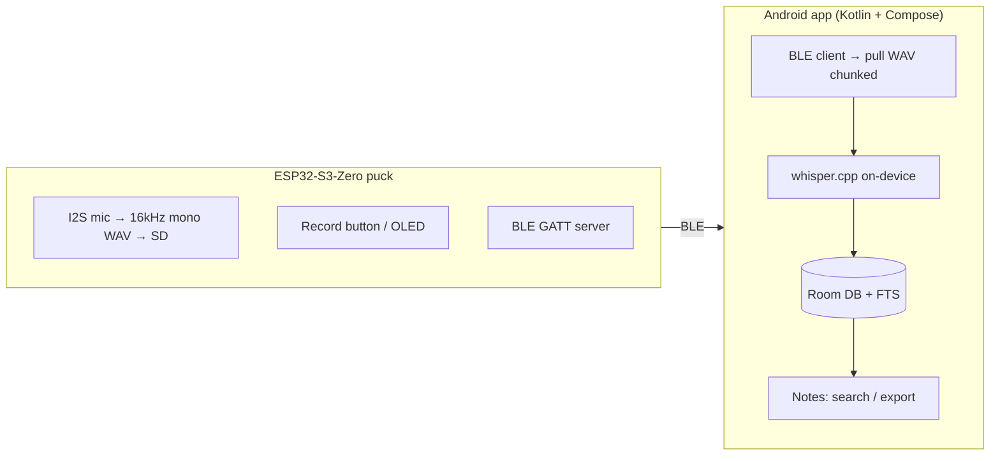

# [WIP] Pocket Voice Recorder

> **Work in progress.** Nothing here has been fully validated on physical hardware yet —
> firmware is unflashed, the app is unbuilt, and the enclosure is unprinted. The `[WIP]`
> marker and these notices will be removed once first tested versions of everything are
> in my hands physically.

A pocket-sized, fully offline voice recorder. An ESP32-S3 puck captures audio to a
microSD card, syncs to an Android app over Bluetooth Low Energy, and transcribes
on-device with whisper.cpp. **No server, no cloud, fully private.** Housed in a
custom 3D-printed card-shaped enclosure.



Build log with bench photos: **<https://quantum-crowbar.github.io/whisper/>**

The full design — hardware BOM, pinout, firmware status, app architecture, and
roadmap — lives in **[specs.md](specs.md)**.

## Repository layout

| Path | Contents |
|---|---|
| [firmware/](firmware/) | ESP32-S3 Arduino/PlatformIO project |
| [android/](android/) | Android app (Kotlin + Jetpack Compose) |
| [hardware/](hardware/) | [Pinout](hardware/pinout.md) + [enclosure](hardware/enclosure/) CAD/STLs |
| [docs/](docs/) | Additional design docs |
| [quantum-basics/](quantum-basics/) | Submodule — agent rules/preferences/skills |
| [specs.md](specs.md) | Master specification (single source of truth) |
| [AGENTS.md](AGENTS.md) | How AI assistants should work in this repo |
| [CONTEXT.md](CONTEXT.md) | Distilled project context for agents |

## Working in this repo

Agent rules and project context: see [AGENTS.md](AGENTS.md) and [CONTEXT.md](CONTEXT.md).

After cloning, activate the commit hook (strips AI attribution from commits) and pull
the submodule:

```sh
git submodule update --init
git config core.hooksPath .githooks
```

## Status

Early bring-up. See the [roadmap in specs.md](specs.md#5-roadmap) for current phase.

- **Phase 0** — Hardware bring-up (in progress)
- **Phase 1** — Base firmware (v0.1 written, not yet flashed/validated)
- **Phase 2** — BLE sync (BLE-only confirmed; no Classic BT on ESP32-S3)
- **Phase 3** — Android app
- **Phase 4** — 3D-printed enclosure
- **Phase 5** — Polish (VAD, deep sleep)
