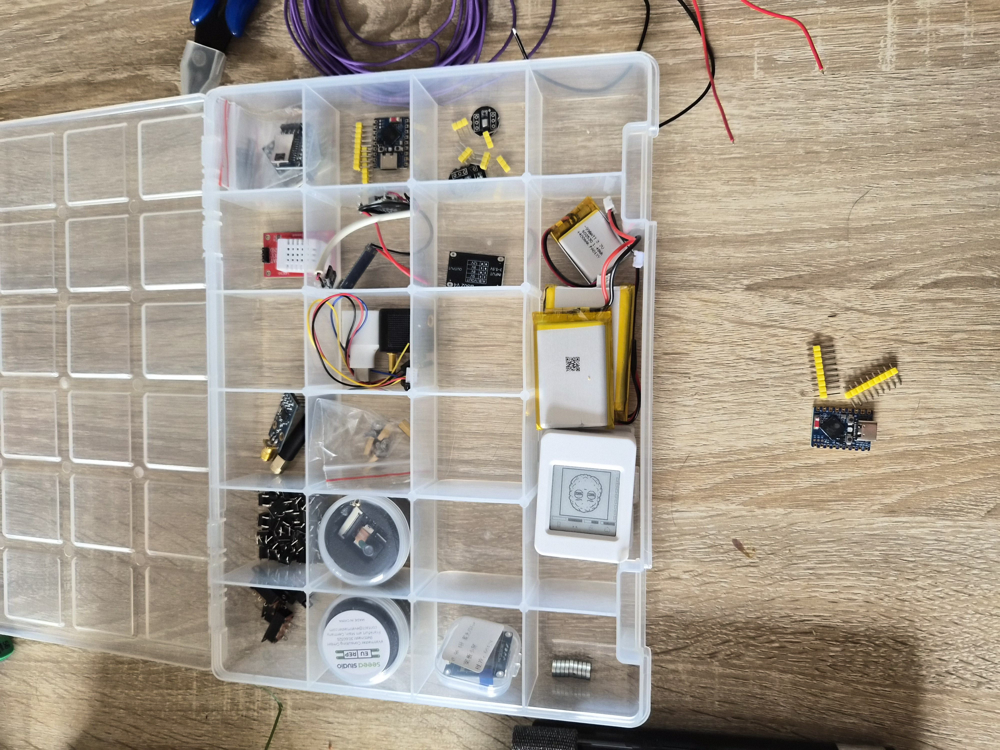
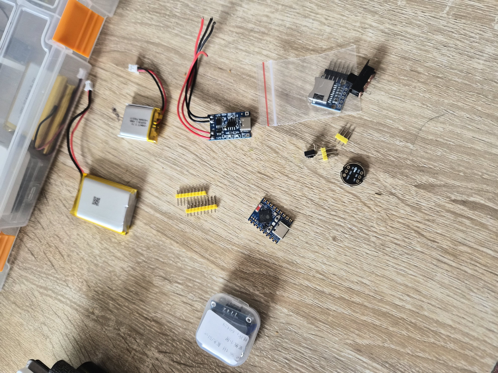
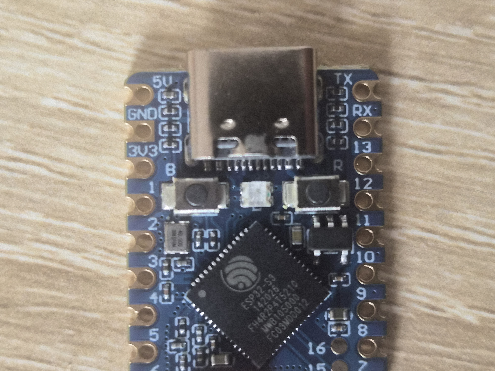
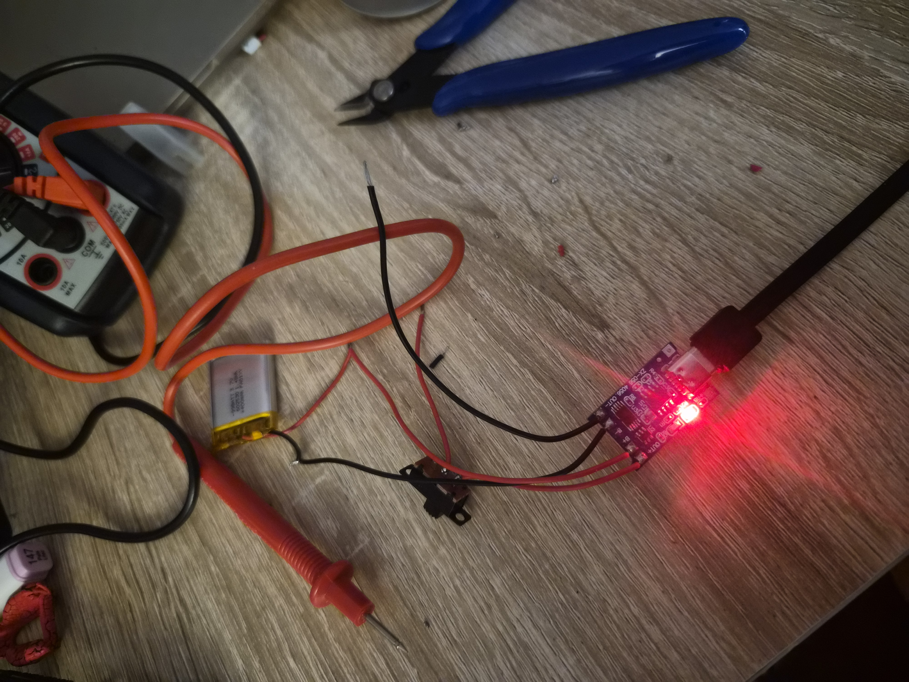
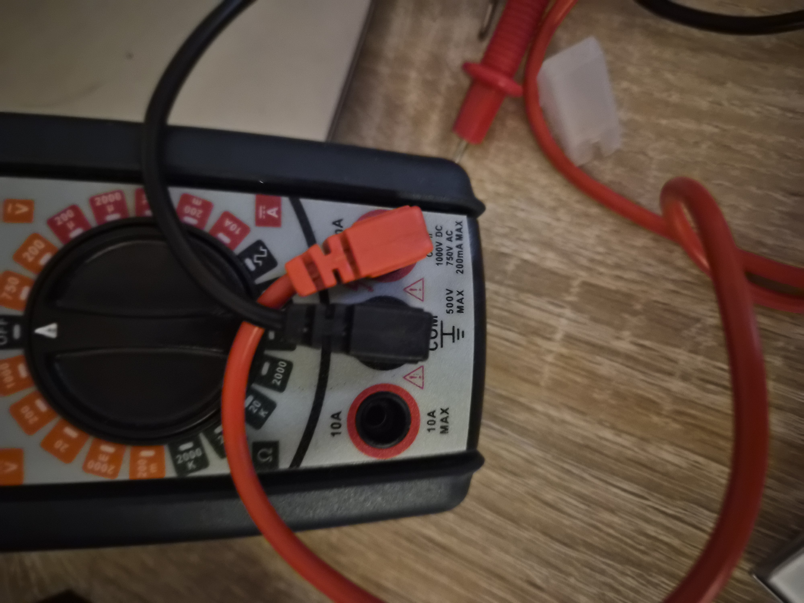

# Devlog

Running log of development — hardware bring-up photos, bench-test results, firmware
notes, dead ends, decisions. Newest entries at the top.

Photos live in [assets/](assets/); reference them with relative paths so they render on
GitHub.

## How to add an entry

Copy the template, fill it in, drop any photos in `assets/` named
`YYYY-MM-DD-short-name.jpg`, and add newest-first under the log.

```markdown
## YYYY-MM-DD — <short title>

**Phase:** <0–5 / which>  ·  **Status:** <what changed>

<A few sentences: what you did, what worked, what didn't, next step.>


```

Keep entries short. This is a log, not a report — a couple of sentences and a photo is plenty.

---

## Log

## 2026-08-09 — Inventory check + power chain assembled

**Phase:** 0 · **Status:** power chain soldered and verified working

Checked the inventory and confirmed the whole BOM is accounted for, then roughly
assembled the power chain — a quick bit of soldering done while supporting my son's
drawing session. Power chain works.

The fun part: today's work was so simple and straightforward that it got *messy* when
it didn't seem to work — I had no output power. After desoldering and resoldering 2–3
times, I realized one of the multimeter cables (the ground one) was slightly loose,
pulled out just enough to not measure. The power chain had been fine the whole time; the
measurement was the problem.







## 2026-08-08 — Repo bootstrapped

**Phase:** 0–1 · **Status:** docs/scaffolding only, no hardware work logged yet

Set up the repo from the spec: firmware/android/hardware/docs scaffold, pinout, BOM,
roadmap, and agent docs. quantum-basics attached as a submodule. No soldering or
bench-testing done yet — puck parts are in hand except the microSD card and LiPo
(pending purchase). First hardware entry will land once headers are soldered and the
mic/OLED/button bench-test runs.

<!-- Add new entries above this line, newest first. -->
