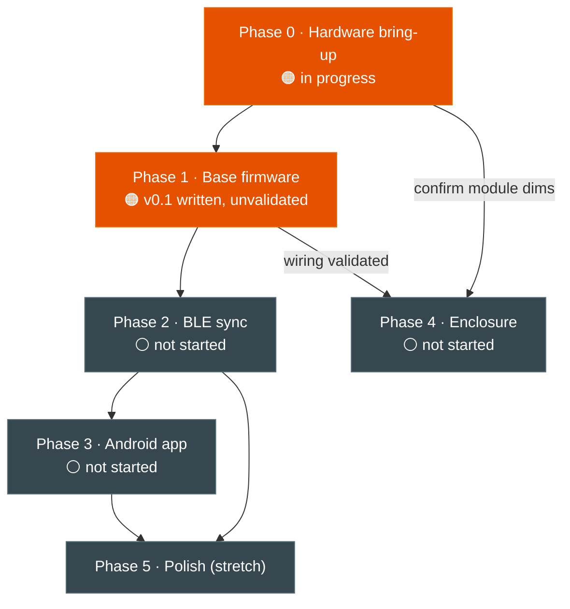

# Roadmap

Working roadmap for the Pocket Voice Recorder. [specs.md §5](../specs.md#5-roadmap) is
the source of truth for phase scope; this file adds dependencies, critical path,
blockers, and milestones.

> **Sequence, not schedule.** No committed calendar dates yet — order reflects
> dependencies, not deadlines. Status is honest: nothing is validated on physical
> hardware yet.

## Status legend

- ✅ done · 🟠 in progress · ⚪ not started · ⛔ blocked (waiting on a purchase/decision)

## Phase dependencies

Phase 3's app work (Compose UI, whisper.cpp integration, Room + FTS) can be built in
**parallel** against sample WAV files before Phase 2's BLE transfer exists — only the
"pull over BLE" step truly depends on Phase 2.

## Critical path

`Phase 0 bench-test → Phase 1 flash+validate → Phase 2 BLE sync → Phase 3 pull+transcribe`

The gate on everything is Phase 0: no firmware claim is real until peripherals are
validated on hardware.

## Blockers & what can proceed now

**⛔ Blocked on purchases** (specs.md §2.1):
- microSD card (16–32GB, Class 10) → blocks SD write bench-test

**In hand since 2026-09-05:** LiPo battery — 400mAh, under the 500–800mAh target, so
runtime needs a real measurement before Phase 4 (see [BOM notes](../hardware/bom.md#notes)).

**Can proceed without that purchase:**
- Bench-test I2S mic, OLED, and record button (assembly is soldered; no SD needed)
- Scaffold the Android project; integrate whisper.cpp against sample WAVs
- Confirm the SD reader module's real footprint (drives enclosure sizing — specs.md §7)

## Milestones

| # | Milestone | "Done" means | Needs |
|---|---|---|---|
| M1 | **Bench proof** | Records a playable 16kHz WAV to SD on real hardware; all peripherals validated | Phase 0 + 1 |
| M2 | **Wireless sync** | A recording pulls from puck to phone over BLE | Phase 2 + Phase 3 BLE client |
| M3 | **End-to-end on-device** | Record → sync → transcribe → searchable note, fully offline | Phase 3 |
| M4 | **Wearable** | Runs on battery inside the printed enclosure | Phase 4 |

**Remove `[WIP]`** (per the [README notice](../README.md)) when first tested versions of
all three deliverables — firmware, app, enclosure — are physically in hand (≈ M4).

---

## Phase detail

### Phase 0 — Hardware bring-up · 🟠
- [x] Source all core modules
- [x] Wire TP4056 with B+/B− and OUT+/OUT− leads
- [x] Boost converter (BS02 V4, A/B jumpers → 5V) between TP4056 and S3; slide switch upstream of booster
- [x] OLED powered (booster GND, S3 3V3 → VCC); record button on GPIO1
- [ ] ⛔ microSD card (pending purchase)
- [x] LiPo battery in hand (400mAh — under target, runtime TBD)
- [x] Full assembly soldered 2026-10-11: OLED I2C (GPIO8/9), mic (GPIO4/5/6), SD reader (GPIO10–13) ([pinout](../hardware/pinout.md))
- [x] Power-up smoke test on battery; charging and rail voltages (incl. BS02 V4 5V output) measured 2026-10-11
- [ ] Bench-test each peripheral individually: I2S → SD → OLED → button → power

### Phase 1 — Base firmware · 🟠 (v0.1 written, not flashed)
- [x] I2S mic capture → 16kHz mono WAV on SD
- [x] Record button toggle (debounced)
- [x] OLED status screen (idle/recording, filename, elapsed, free space)
- [ ] Re-pin sketch to the as-built GPIOs (SD 10–13, OLED 8/9, button 1), then flash and validate  ← M1 gate
- [ ] Add battery % to OLED (needs battery + ADC wiring — TBD)

### Phase 2 — BLE sync · ⚪
- [x] Resolved: BLE only (no Classic BT on ESP32-S3)
- [ ] GATT server: file-list characteristic + chunked file transfer (notify) + control commands
- [ ] MTU negotiation (≥247) for throughput
- [ ] Long-press on record button = sync mode (short = record)

### Phase 3 — Android app · ⚪
- [ ] BLE GATT client: scan, connect, discover services
- [ ] Pull WAV files; list/manage recordings  ← depends on Phase 2
- [ ] whisper.cpp Android bindings (target: `small`/`medium` on Snapdragon 8 Elite)
- [ ] Room DB + FTS search
- [ ] Notes screen: list, search, read, export via share sheet

### Phase 4 — 3D-printed enclosure · ⚪
- [ ] Confirm real module dimensions (esp. SD reader ~29×48mm footprint)
- [ ] Layout: mic acoustic port, OLED window, button/switch cutouts, dual USB-C access
- [ ] Model in CAD (tool TBD — specs.md §7)
- [ ] Print test fit **before** final wiring is permanent

### Phase 5 — Polish (stretch) · ⚪
- [ ] VAD auto-record trigger
- [ ] Deep sleep between recordings
- [ ] Battery indicator refinement
