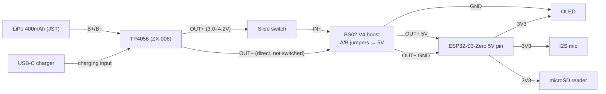

# Wiring & Pinout

Target MCU: **Waveshare ESP32-S3-Zero** (USB-C, no built-in mic/SD, no JST charging).
Silkscreen pin numbers are GPIO numbers directly.

**Status: full assembly soldered (2026-10-11); not yet bench-tested.** Treat this file as
the as-built wiring (slide switch and GPIO1 button confirmed in place). If the hardware
and this file disagree, fix the file and note it in the devlog.

Full connection map (all GPIOs, rails, power chain): [wiring-diagram.md](wiring-diagram.md).

## GPIO summary

| GPIO | Function | Peripheral |
|---|---|---|
| 1 | Button input (`INPUT_PULLUP`) | Record button |
| 4 | I2S BCLK | Mic |
| 5 | I2S WS | Mic |
| 6 | I2S DIN (mic SD) | Mic |
| 8 | I2C SDA | OLED |
| 9 | I2C SCL | OLED |
| 10 | SPI CS | microSD |
| 11 | SPI MOSI | microSD |
| 12 | SPI SCK | microSD |
| 13 | SPI MISO | microSD |

OLED and microSD sit on the ESP32-S3 Arduino core defaults (I2C `Wire` = GPIO8/9, SPI
FSPI = GPIO10–13), so `Wire.begin()` and `SPI.begin()` need no pin arguments.

## I2S microphone (MEMS breakout)

| Mic pin | ESP32-S3-Zero |
|---|---|
| VDD | 3V3 |
| GND | GND |
| SCK (BCLK) | GPIO4 |
| WS (LRCLK) | GPIO5 |
| SD (DOUT) | GPIO6 |
| L/R | GND (mono, **left** channel; tie to 3V3 for right) |

## SPI microSD reader

| SD pin | ESP32-S3-Zero |
|---|---|
| VCC | 3V3 |
| GND | GND |
| CS | GPIO10 |
| MOSI | GPIO11 |
| SCK | GPIO12 |
| MISO | GPIO13 |

## I2C OLED (SSD1306, 0.96" 128×64, addr 0x3C)

| OLED pin | ESP32-S3-Zero |
|---|---|
| GND | GND |
| VCC | 3V3 |
| SDA | GPIO8 |
| SCL | GPIO9 |

## Record button

One leg to **GPIO1**, diagonal leg to **GND**, configured `INPUT_PULLUP`.
Short press = record toggle; long press = sync mode (planned).

GPIO1 is not a strapping pin on the ESP32-S3, so pulling it low at boot is safe.

## Power chain

The TP4056 outputs raw cell voltage (~3.0–4.2V, sagging as the cell discharges) — too low
and too unstable for the S3's 5V pin, and above the ESP32-S3's ~3.6V absolute max if fed
to 3V3 at full charge. The **BS02 V4** boost module sits between them and holds 5V
regardless of charge state; the S3's onboard LDO then makes 3.3V for every peripheral.

- The BS02 V4 output voltage is set by its **A/B solder-jumper pads** (set to 5V).
- Only the positive rail is switched; charging works regardless of switch position.
- The slide switch is **upstream of the booster**, so it gates the converter too (no
  quiescent draw from the boost module when off).
- The OLED takes **GND from the booster** and **VCC from the S3's 3V3 pin** — the screen
  runs off the S3's onboard regulator, not the 5V rail.
- Mic, OLED, and SD all draw from the S3's 3V3 pin, so the onboard LDO carries the whole
  peripheral load (SD write bursts are the peak).

## Reserved / avoid

| GPIO | Why |
|---|---|
| 0 | BOOT strapping pin |
| 3, 45, 46 | Strapping pins |
| 19 / 20 | Internal USB D− / D+ (native USB-C) |
| 21 | Onboard WS2812 RGB LED |
| 43 / 44 | UART0 TX / RX (default serial) |
| 33–37 | Not exposed (octal PSRAM) |

## Open items

- **Verify BS02 V4 jumper setting.** Confirm the A/B solder bridges give 5V: measure
  OUTPUT+/OUTPUT− with a multimeter, and check bridge continuity under magnification.
- **USB back-feed.** Plugging USB-C into the S3 while the booster drives its 5V pin puts
  two 5V sources on one rail. Check the Waveshare schematic for a diode between VBUS and
  the 5V pin before relying on this.
- **SD reader supply.** If the reader module has its own LDO (common), 3V3 in may leave
  the card under-powered; if the card is flaky at bench-test, feed VCC from the booster's
  5V instead.
- Firmware sketch must be updated to these pins (it was written against the previous
  pin plan: SD on GPIO7–10, OLED on GPIO11/12).

## Board setting

"ESP32S3 Dev Module", **USB CDC on boot enabled** (for Serial over native USB-C).
