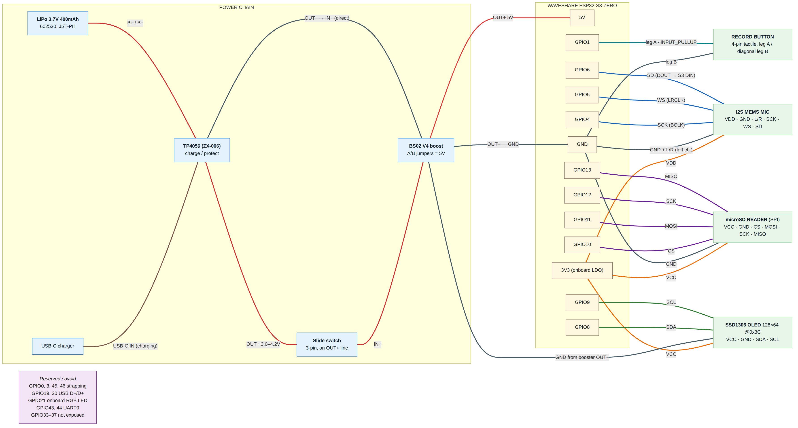
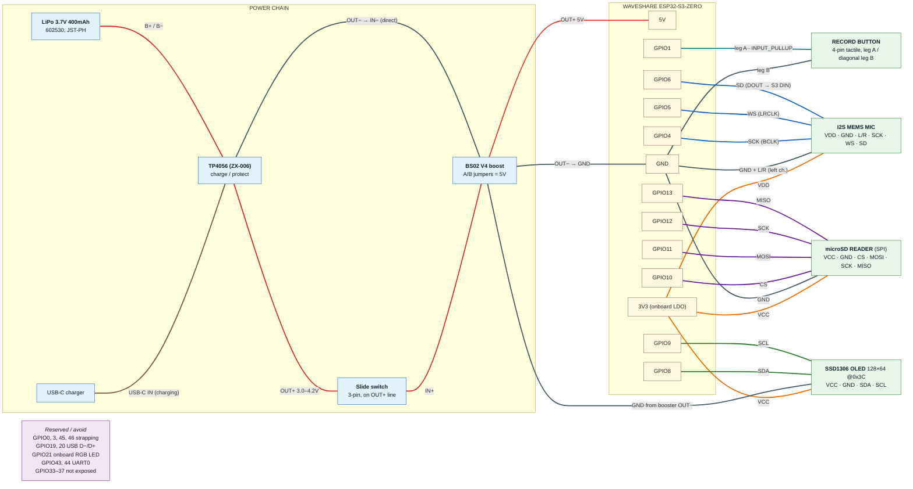

# Wiring diagram

Full as-built connection map: every GPIO, rail, and power-chain wire. Companion to
[pinout.md](pinout.md), which holds the same assignments as tables — if the two disagree,
fix both.



Line colours: red = battery / 5V, orange = 3V3, grey = GND, blue = I2S, green = I2C,
purple = SPI, teal = button, brown = USB-C charge input.

## Source

The Mermaid below is the source of truth; the PNG is rendered from it.



Re-render after editing (needs `@mermaid-js/mermaid-cli`):

```sh
awk '/^```mermaid/{f=1;next} /^```/{f=0} f' wiring-diagram.md > /tmp/wiring.mmd
mmdc -i /tmp/wiring.mmd -o wiring-diagram.png -s 2 -w 1800 -b white
```
