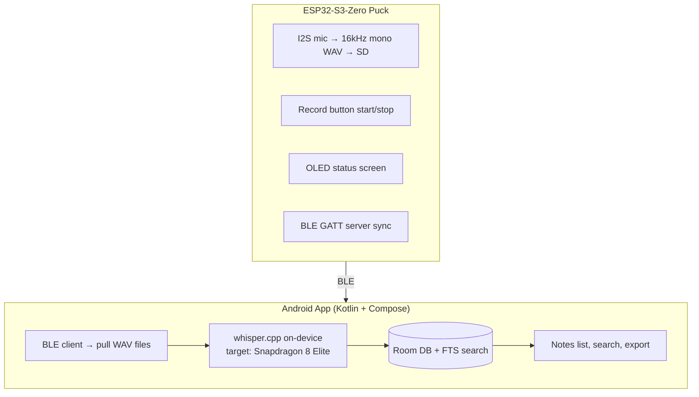
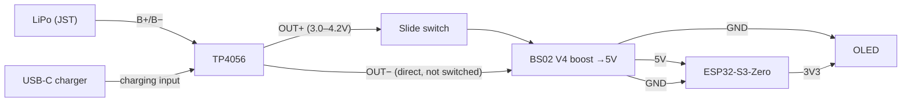

# Pocket Voice Recorder

A pocket-sized, fully offline voice recorder: ESP32-S3 captures audio to a microSD card, syncs to an Android app over Bluetooth Low Energy, and transcribes on-device using whisper.cpp. No server, no cloud, fully private. Housed in a custom 3D-printed card-shaped enclosure.

---

## 1. Overview



No WiFi, no backend server — sync and transcription are fully local to the phone.

---

## 2. Hardware

### 2.1 Bill of Materials

| Part | Detail | Status |
|---|---|---|
| MCU | Waveshare ESP32-S3-Zero (USB-C, no built-in mic/SD, no JST charging) | ✅ have |
| Microphone | I2S MEMS mic breakout (GND/VDD/SD/L·R/WS/SCK) | ✅ have |
| SD reader | SPI microSD reader module (GND/VCC/MISO/MOSI/SCK/CS), ~29×48mm | ✅ have |
| microSD card | 16–32GB, Class 10 | ⏳ pending |
| Display | 0.96" 128×64 I2C OLED (SSD1306, GND/VCC/SCL/SDA, addr 0x3C) | ✅ have |
| Charge/protect | TP4056 with protection circuit, USB-C, wired with B+/B− and OUT+/OUT− leads | ✅ have |
| Battery | LiPo 3.7V 400mAh (602530, 1.48Wh) — under the 500–800mAh target | ✅ have |
| Power switch | Mini slide switch, 3-pin | ✅ have |
| Record button | 4-pin tactile push button | ✅ have |
| Boost converter | BS02 V4 step-up module, A/B solder jumpers set to 5V (TP4056 OUT+ → S3 5V pin) | ✅ have |

### 2.2 Pinout

**I2S microphone**
| Mic pin | ESP32-S3-Zero |
|---|---|
| VDD | 3V3 |
| GND | GND |
| SCK (BCLK) | GPIO4 |
| WS (LRCLK) | GPIO5 |
| SD (DOUT) | GPIO6 |
| L/R | GND (mono, left channel) |

**SPI microSD**
| SD pin | ESP32-S3-Zero |
|---|---|
| VCC | 3V3 |
| GND | GND |
| CS | GPIO10 |
| MOSI | GPIO11 |
| SCK | GPIO12 |
| MISO | GPIO13 |

**I2C OLED**
| OLED pin | ESP32-S3-Zero |
|---|---|
| GND | GND |
| VCC | 3V3 |
| SDA | GPIO8 |
| SCL | GPIO9 |

**Record button** — one leg to GPIO1, diagonal leg to GND, `INPUT_PULLUP`.

**Power chain**

Only the positive rail is switched; charging works regardless of switch position.

### 2.3 Enclosure

- Form factor: elongated "half-card," roughly 92×32mm footprint, ~10–12mm thick to stack MCU + TP4056 + LiPo + SD reader
- Front face: OLED window, record button, mic port, optional status LED
- One short edge: dual USB-C cutouts (ESP32's own port + TP4056's charging port)
- Opposite short edge: SD card slot + power switch
- Biggest open risk: SD reader module (~29×48mm) may drive case size more than any other part — confirm real module dimensions before finalizing CAD
- CAD tool: TBD (Fusion 360 / FreeCAD / OpenSCAD)

---

## 3. Firmware

**Status: v0.1 written, not yet flashed/validated on hardware.**

Current features:
- I2S mic capture → 16kHz mono WAV file on SD
- Record button toggles recording (debounced)
- OLED shows state (idle/recording), filename, elapsed time, free SD space
- WAV header written with placeholder sizes, patched on file close

Not yet implemented:
- BLE sync (GATT server, file list + chunked transfer)
- VAD (voice activity detection) auto-trigger
- Deep sleep / power management
- Battery percentage on screen (needs ADC on battery rail — TBD)

Libraries: `Adafruit_GFX`, `Adafruit_SSD1306`, plus core `SD`, `SPI`, `Wire`, `driver/i2s.h` from the ESP32 Arduino core.

Board setting: "ESP32S3 Dev Module," USB CDC on boot enabled (for Serial over native USB-C).

**Confirmed hardware constraint:** ESP32-S3 supports **BLE only** — no Classic Bluetooth (BR/EDR/SPP). This is a chip-level limitation (only the original non-S/non-C ESP32 has Classic BT), so sync must be built as a BLE GATT service, not a serial-style SPP link. Expect lower throughput (~20–500 KB/s vs. SPP's ~1–2 Mbps) — fine for short clips, needs chunked transfer with progress feedback for longer recordings. Negotiate a larger MTU (247+) on connect to help.

---

## 4. Software (Android app)

**Stack:** Kotlin + Jetpack Compose, MVVM.

**Target device:** Flip 7 (Snapdragon 8 Elite) — expected to run whisper.cpp `small`/`medium` comfortably on-device.

**Flow:**
1. BLE scan/connect to the recorder (GATT client)
2. Pull file list, then pull WAV files (chunked over BLE)
3. Queue files for on-device transcription via whisper.cpp Android bindings
4. Store transcripts in Room DB with FTS search
5. Notes screen: list, search, tap to read, export via share sheet

**Screens:** Home (device status/connect), Record view (recording list on device), Sync & Transcribe (pull + transcription queue/progress), Notes (transcript list/search/export).

**No server component** — this is the key architectural decision distinguishing this from typical "AI note taker" products: everything stays on-device.

---

## 5. Roadmap

### Phase 0 — Hardware bring-up (in progress)
- [x] Source all core modules
- [x] Wire TP4056 with B+/B− and OUT+/OUT− leads
- [ ] microSD card (pending purchase)
- [x] Boost converter (BS02 V4, 5V) between TP4056 and S3; slide switch upstream of booster
- [x] LiPo battery in hand (400mAh — under target, runtime TBD)
- [x] Full assembly soldered, all peripherals wired (2026-10-11)
- [x] Power-up smoke test on battery; charging and rail voltages measured (2026-10-11)
- [ ] Bench-test each peripheral individually (I2S → SD → OLED → button → power)

### Phase 1 — Base firmware (v0.1 done)
- [x] I2S mic capture → WAV on SD
- [x] Record button toggle
- [x] OLED status screen
- [ ] Flash and validate on real hardware
- [ ] Add battery % to OLED once battery/ADC wiring is in place

### Phase 2 — BLE sync
- [x] Resolved: BLE only (no Classic BT on ESP32-S3)
- [ ] GATT server: file list characteristic + chunked file transfer (notify) + control commands
- [ ] MTU negotiation for throughput
- [ ] Trigger sync via long-press on record button (short = record, long = sync mode)

### Phase 3 — Android app
- [ ] BLE GATT client: scan, connect, discover services
- [ ] Pull WAV files, list/manage recordings
- [ ] whisper.cpp Android bindings integration
- [ ] Room DB + FTS search
- [ ] Notes screen: list, search, export

### Phase 4 — 3D printed enclosure
- [ ] Confirm real module dimensions (especially SD reader footprint)
- [ ] Layout: mic acoustic port, OLED window, button/switch cutouts, dual USB-C access
- [ ] Model in CAD
- [ ] Print test fit before final wiring is permanent

### Phase 5 — Polish (stretch)
- [ ] VAD auto-record trigger
- [ ] Deep sleep between recordings
- [ ] Battery indicator refinement

---

## 6. Suggested repo structure

```
/firmware          ESP32-S3 Arduino/PlatformIO project
/android            Android app (Kotlin + Compose)
/hardware
  /pinout.md        (or fold into this README)
  /enclosure         CAD files, exported STLs
/docs
  README.md          (this file)
```

---

## 7. Open questions

- CAD tool preference for the enclosure
- Whether the mic needs a felt/mesh dust cover behind its acoustic port
- Exact SD reader module footprint vs. final case dimensions
